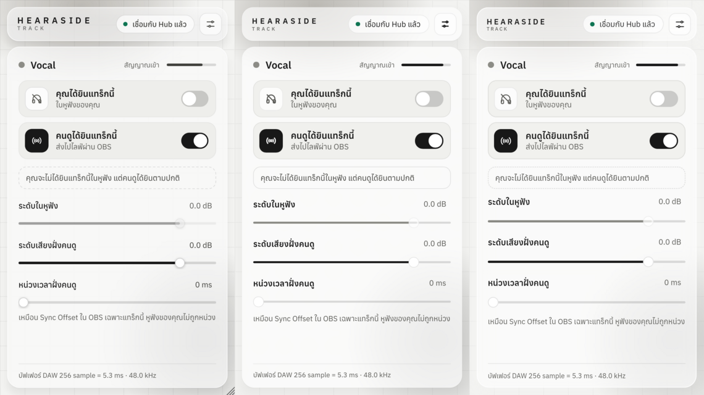
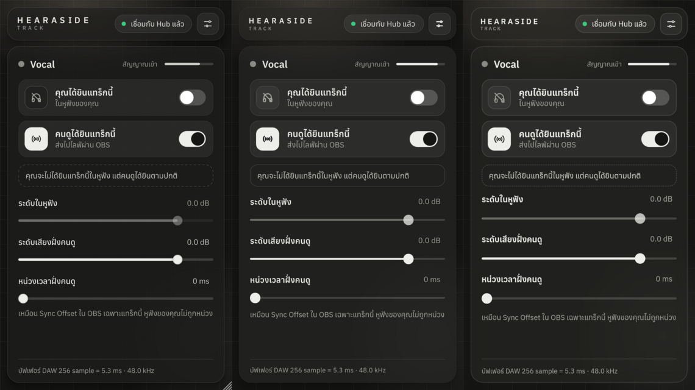

# R0.3 spike UI: Slint กับ Vizia (ส่วนที่ทำใน cloud)

29 ต.ค. 2026 · Linux x86_64 (Ubuntu 24.04), Rust 1.99.0 · โค้ดอยู่ที่ `rust/spikes/ui-slint` และ `rust/spikes/ui-vizia`
(ไม่อยู่ใน workspace หลัก ไม่ใช่โค้ดที่ส่งผู้ใช้)

## ทำอะไร

ทำหน้าหลักของ HEARASIDE Track ซ้ำทั้งสอง framework ตาม layout จริงใน `plugins/track/TrackEditor.cpp`
(หน่วยเนื้อหา 380 × 640, header 54, การ์ด, แถว คุณได้ยิน / คนดูได้ยิน, ประโยคสรุป, 3 สไลเดอร์, footer)
สีจาก `design/tokens.json` ไอคอนจาก `plugins/common/ui/Icons.cpp` ฟอนต์ Anuphan 400/500/600
แล้วเทียบกับภาพของ UI เดิมที่ `tools/ui-snapshot` เรนเดอร์ (ภาษาไทย, ขนาด UI 125 % ที่ 2x = scale 2.5)

- Slint 1.18.1: software renderer เรนเดอร์ลง buffer โดยไม่เปิดหน้าต่าง พื้นหลังกระจกขุ่นพอร์ตจาก
  `plugins/common/ui/Backdrop.cpp` (กระดาษ, grid 40, blob 2 ก้อน, สำเนาเบลอ + veil + เงา + ขอบ) เรนเดอร์ไว้ก่อน
- Vizia 0.4.0 (Skia): ต้องมีหน้าต่างจริง จึงรันใต้ Xvfb แล้วจับภาพ (`capture.sh`) ใช้ชั้นกระดาษ/grid/blob
  จากโค้ดเดียวกัน แต่กระจกใช้ `backdrop-filter: blur(18px)` ของ Vizia เอง

ภาพเทียบ (ซ้าย → ขวา: UI เดิม JUCE, Slint, Vizia):




ภาษาไทยที่ 100 % (Slint ซ้าย, Vizia ขวา): `r03/thai-100.png` · มืด 150 %: `r03/thai-150-dark.png`

## ผลตามเกณฑ์ 6 ข้อ (PLAN หัวข้อ D2) + Q8

| เกณฑ์ | Slint | Vizia |
|---|---|---|
| 1. ข้อความไทย Anuphan 400/500/600 ที่ 100/150/200 % | ✅ สระบน/ล่าง วรรณยุกต์ซ้อน ("ซ้ำ", "นี้", "ฝั่ง", "ซิงค์") ถูกทุกขนาด | ✅ ถูกทุกขนาด |
| 2. เปิด/ปิด editor 50 รอบใน 5 DAW | ⏳ ต้องทดสอบในเครื่อง | ⏳ ต้องทดสอบในเครื่อง |
| 3. เปิด ≤ 150 ms, RAM ≤ 40 MB ต่อ editor | สร้าง component 0.1–0.2 ms, เฟรมแรก 2–14 ms (100–250 %) · พื้นหลังที่เรนเดอร์ไว้ก่อน 36–390 ms เพราะโค้ด spike ใช้ f32 ทั้งภาพ ยังไม่ optimize (JUCE ทำงานเดียวกันและ cache ไว้) · RSS สูงสุด 81 MB ซึ่งส่วนใหญ่เป็น buffer f32 ของพื้นหลัง ⏳ ต้องวัดใหม่หลัง optimize ใน DAW | สร้างหน้า 75 ms (100 %) / 145 ms (200 %) · RSS 150–198 MB แต่วัดบน Mesa llvmpipe (GL แบบ software) จึงยังสรุปไม่ได้ ⏳ ต้องวัดบน GPU จริง |
| 4. กระจกขุ่นแบบ pre-render + ธีมสว่าง/มืด | ✅ (ไม่มี backdrop blur ในตัว จึง pre-render แบบเดียวกับ JUCE) · ตามธีมระบบ: ยังไม่ทดสอบ | ✅ blur จริงในตัว (`backdrop-filter`) · ตามธีมระบบ: ยังไม่ทดสอบ |
| 5. เรนเดอร์ PNG โดยไม่มีหน้าต่าง (แทน `ui-snapshot`) | ✅ software renderer ตรง ๆ | ❌ ต้องมีหน้าต่าง (ใช้ Xvfb + จับภาพแทนได้บน Linux CI) |
| 6. พิมพ์ไทย (IME) ใน DAW 3 ตัว | ⏳ ต้องทดสอบในเครื่อง | ⏳ ต้องทดสอบในเครื่อง |
| Q8 หน้าตาเหมือนเดิม | ✅ ใกล้มาก ต่างแค่ขอบเส้นประของกล่องสรุป (Slint ไม่มี dashed border ต้องวาดเองด้วย Path) | ✅ ใกล้มาก มี dashed border, เว้นระยะสไลเดอร์ต่างเล็กน้อย |

## ข้อสังเกตอื่น

- **ฝังใน DAW:** บน crates.io ไม่มี adapter ของ nice-plug สำหรับ Slint หรือ Vizia (มี `nice-plug-egui`,
  `nice-plug-iced`) ต้องตรวจ adapter จาก git หรือเขียนเองใน R0.4: Slint ต่อผ่าน `slint::platform` +
  software renderer ลง HWND/NSView ได้, Vizia มี backend baseview ในโปรเจกต์ต้นทาง
- **AU บน macOS:** มี `nice-plug-au2` บน crates.io (ข้อมูลสำหรับ D1 / Q4)
- **ขนาดไบนารี spike (release, Linux):** Slint 9.7 MB, Vizia 27 MB (Skia)
- **Build:** Vizia ดาวน์โหลดไบนารี Skia สำเร็จรูปตอน build และต้องมี GL/EGL dev ส่วน Slint เป็น Rust ล้วน
- **License:** Slint ใช้แบบ royalty-free ต้องแสดงเครดิต (หรือ GPLv3) · Vizia MIT
- **Vizia:** `.tile.on svg` ใน CSS ไม่ restyle ลูก และ SVG ไม่รองรับ `currentColor` ต้องใช้ CSS `fill` + สลับ 2 ไอคอนด้วย `display`
- **Slint:** animation ต้องเดินเวลาให้จบก่อนถ่ายภาพ (`update_timers_and_animations`)

## ปลั๊กอินเปล่า (VST3 + CLAP)

`rust/spikes/plugins/track-slint` และ `track-vizia` เป็นปลั๊กอิน stereo pass-through ที่มีหน้า Track เดียวกัน
(พารามิเตอร์ You hear, Viewers hear, ระดับ 2 ตัว, delay, และสวิตช์ธีมมืดสำหรับทดสอบ) บน nice-plug 0.1.8
แยกเป็นคนละ workspace เพราะ Slint กับ Vizia ลิงก์ Skia คนละรุ่น

- Slint: adapter เขียนเองบน `slint-baseview` 0.1.0 (Slint 1.16.1, FemtoVG/OpenGL) สวิตช์ ↔ พารามิเตอร์ทั้งสองทาง (automation จาก host ขึ้น UI ด้วย)
- Vizia: `vizia-plug` (git, ของทีม Vizia) + vizia git rev `bbf98e6` สวิตช์ส่งค่าไป host ได้ แต่ automation จาก host ยังไม่ขึ้น UI
- footer ของแต่ละตัวบอกเวลาที่ใช้เปิด editor
- `nice-plug` 0.4.x (รุ่นล่าสุด) เปลี่ยน Editor API และ baseview แล้ว ทั้ง `slint-baseview` และ `vizia-plug` ยังผูกกับ API รุ่น 0.1.x
  ถ้าเลือก nice-plug 0.4 ต้องเขียน adapter ใหม่เอง

ทดสอบในเครื่องนี้ (Linux, Xvfb + openbox, OpenGL แบบ software) ด้วย `plugin-host-test --editor-soak` (JUCE host
เปิด/ปิด editor ซ้ำ วัดเวลาและ RAM):

| | Slint (slint-baseview) | Vizia (vizia-plug) |
|---|---|---|
| ภาษาไทยใน host จริง | ✅ | ✅ |
| เปิด editor (create + attach) | 97–142 ms | 108–187 ms |
| RAM เมื่อเปิด editor ตัวแรก | +130 MB | +154 MB |
| เปิด/ปิดซ้ำ | 5 รอบผ่าน แต่ 30 รอบล่มทุกครั้ง: baseview 0.1.4 สร้าง GL context ไม่ได้ (X11 BadDrawable) แล้ว panic ทำให้ host ล่มทั้งโปรแกรม | 30 รอบผ่าน |
| RAM หลังปิดครบ | ไม่คืน (+258 MB หลัง 5 รอบ) | ไม่คืน (+238 MB หลัง 30 รอบ) |

ข้อควรระวัง: ตัวเลข RAM/เวลานี้มาจาก Mesa llvmpipe ซึ่งกิน RAM มากและช้ากว่า GPU จริงมาก ใช้เทียบกันได้แต่ไม่ใช่ค่าจริง
ทั้งสองตัวต้องการ framebuffer แบบ sRGB ซึ่ง Xvfb ไม่มี จึงต้องปิดด้วย `HS_SPIKE_NO_SRGB=1` (Slint) หรือ patch baseview
ชั่วคราวตอนทดสอบ (Vizia, ไม่ได้ commit) ประเด็นที่สำคัญกว่าตัวเลขคือ **ถ้าสร้าง OpenGL ไม่ได้ baseview จะ panic
แล้วพา DAW ล่มตาม** (JUCE จะแค่เปิด editor ไม่ขึ้น) ต้องแก้ด้วย `catch_unwind` หรือ fallback เป็น software renderer
ก่อนใช้จริง และควรมีทางเลือก software rendering (Slint ทำได้ ดู headless spike) สำหรับเครื่องที่ GPU/ไดรเวอร์มีปัญหา

ไฟล์ปลั๊กอินสำหรับ Windows และ macOS (arm64): workflow `R0.3 spike plug-ins` (`.github/workflows/spike-plugins.yml`)
build ให้ ดาวน์โหลดจาก Artifacts ของ run (`spike-slint-windows-latest` ฯลฯ) ไฟล์ macOS ยังไม่ได้เซ็นชื่อ
ต้องรัน `xattr -dr com.apple.quarantine <bundle>` ก่อนเปิด

## ผลใน DAW จริง (ArmZ, 29 ต.ค. 2026)

Studio One 7 บน Windows: ปลั๊กอินทั้งสองตัวจาก Artifacts โหลดได้ หน้า Track แสดงไทยและหน้าตาตรงของเดิมทั้งคู่
Slint เปิด editor ใน 36 ms (สเกล 1.00) Vizia สร้างหน้าใน 21 ms · **ArmZ เลือก Vizia** (D2 ใน PLAN หัวข้อ 5 "ผล G0")

## สิ่งที่ต้องทำต่อ (ในเครื่อง)

1. เปิดปลั๊กอินทั้งสองตัว (จาก Artifacts) ใน Studio One 7, Cubase 15, Reaper, FL, Ableton บน Windows และ Reaper บน macOS
   (Logic ต้องใช้ AU ยังไม่ได้ทำ) ทดสอบข้อ 2 (เปิด/ปิด 50 รอบ) และ 6 (พิมพ์ไทยในช่องชื่อของ Slint)
2. วัดเวลาเปิด/RAM บน GPU จริง: `plugin-host-test --editor-soak "<ไฟล์ .vst3>" 50` (build ตาม `tools/plugin-host-test/README.md`)
   ดู Task Manager ประกอบ
3. ทดสอบตามธีมระบบ (Windows / macOS)

## รันซ้ำ

```bash
cd rust/spikes/ui-slint && cargo run --release -- <output-dir>
```

```bash
cd rust/spikes/ui-vizia && cargo build --release && ./capture.sh <output-dir>
```

```bash
cd rust/spikes/plugins/track-slint && cargo xtask bundle spike-track-slint --release
```

```bash
plugin-host-test --editor-soak "rust/spikes/plugins/track-slint/target/bundled/HEARASIDE Spike Slint.vst3" 50
```

ภาพอ้างอิง UI เดิม: build target `hearaside_ui_snapshot` (`-DHEARASIDE_BUILD_PLUGINS=ON -DHEARASIDE_BUILD_TOOLS=ON`)
แล้วรัน `xvfb-run hearaside_ui_snapshot <output-dir>` บน Linux
